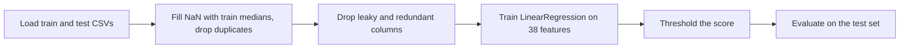

# Linear Regression, Explained: Detecting DDoS Attacks with a Linear Probability Model


A hands-on crash course on **linear regression**, built around a real cybersecurity problem: telling DDoS flood traffic apart from benign traffic using flow-level network features.

The repo has two goals:

1. **Teach** how linear regression works (the math, the assumptions, the metrics, the pitfalls) in plain language.
2. **Show** what it looks like to evaluate a model honestly: a 99.975% accuracy is the start of the analysis, not the end of it.

> **Dataset:** train 16,000 rows, test 4,000 rows, 40 columns (flow features such as `Header_Length`, `Time_To_Live`, `Rate`, TCP flag counts, protocol indicators, and packet-size statistics), plus a `Target` label.
> CIC IoT dataset 2023

---

## Table of contents

1. [TL;DR](#tldr)
2. [Part I: Linear regression crash course](#part-i-linear-regression-crash-course)
3. [Part II: The project](#part-ii-the-project)
4. [Key takeaways](#key-takeaways)
5. [Run it yourself](#run-it-yourself)
6. [Further reading](#further-reading)

---

## TL;DR

- Plain linear regression, used as a classifier by thresholding its output, gets **99.975% accuracy** (1 error in 4,000 test samples) on benign vs. DDoS.
- That does **not** mean the target is a linear function of the features. The classes are almost **linearly separable**, which is a different thing.
- Four things were needed to make the result trustworthy: removing a **leaky column**, removing **duplicate features**, filling missing values using **training medians**, and running **sanity checks** to explain why the score is so high.
- The score holds for the attack types the model was trained on. It does not transfer to unseen attack types.

---

# Part I: Linear regression crash course

## 1. The idea

Linear regression predicts a number by drawing the best straight line (or, with many features, a flat plane) through the data.

With one feature:

$$\hat{y} = w_0 + w_1 x$$

With many features:

$$\hat{y} = w_0 + w_1 x_1 + w_2 x_2 + \dots + w_p x_p = \mathbf{w}^\top \mathbf{x} + b$$

- $\hat{y}$ is the prediction.
- $w_j$ are the **weights** (coefficients): how much the prediction changes when feature $x_j$ increases by one unit, with the other features held fixed.
- $b$ is the **intercept**: the prediction when all features are zero.

## 2. How it learns

"Best line" means the line with the smallest total squared error. The loss is the **mean squared error (MSE)**:

$$\text{MSE}(\mathbf{w}) = \frac{1}{n}\sum_{i=1}^{n}\left(y_i - \hat{y}_i\right)^2$$

There are two common ways to find the weights that minimize it:

| Method | How it works | Used by |
|---|---|---|
| **Ordinary Least Squares (closed form)** | Solves $\hat{\mathbf{w}} = (X^\top X)^{-1} X^\top \mathbf{y}$ directly in one step | scikit-learn's `LinearRegression` |
| **Gradient descent** | Repeatedly nudges the weights downhill on the loss surface | `SGDRegressor`, neural networks |

> If two columns are exact copies of each other, $X^\top X$ cannot be inverted (perfect multicollinearity). scikit-learn does not crash; it returns one of the infinitely many valid solutions. The predictions stay fine, but the individual coefficients become meaningless.

## 3. Assumptions

Linear regression works best when these roughly hold:

| Assumption | Meaning | How to check |
|---|---|---|
| **Linearity** | The target changes linearly with the features | Scatter plots, residual plots |
| **Independence** | Samples don't influence each other | Understand how the data was collected |
| **Constant variance** | Error size is similar across the range of predictions | Residual plot |
| **Normal residuals** | Needed for confidence intervals, not for fitting | Q-Q plot |
| **No multicollinearity** | Features aren't copies or combinations of each other | Correlation matrix, variance inflation factor |

The model can still *predict* well when some assumptions are bent. It is the **interpretation** of coefficients and confidence intervals that breaks first.

## 4. Metrics for regression

| Metric | Formula | Reading |
|---|---|---|
| MSE | $\frac{1}{n}\sum (y_i - \hat{y}_i)^2$ | Penalizes big errors heavily |
| RMSE | $\sqrt{\text{MSE}}$ | Same units as the target |
| MAE | $\frac{1}{n}\sum \lvert y_i - \hat{y}_i \rvert$ | Average absolute error |
| $R^2$ | $1 - \frac{\sum (y_i-\hat{y}_i)^2}{\sum (y_i-\bar{y})^2}$ | Share of variance explained (1 is perfect, 0 is no better than predicting the mean) |

## 5. Using linear regression as a classifier

Our target is not a continuous number. It is a label: **0 = benign, 1 = DDoS**. We can still fit linear regression on these 0/1 values. The output is then a *score*, and we turn it into a class with a threshold $t$:

$$\text{class} = \begin{cases} 1\ (\text{DDoS}) & \text{if } \hat{y} \ge t \\ 0\ (\text{benign}) & \text{if } \hat{y} < t \end{cases}$$

This is called a **Linear Probability Model**. It is quick and simple, but it has known weaknesses:

- Scores can fall **below 0 or above 1**, so they are not probabilities.
- Scores are **not calibrated**: a score of 0.8 does not mean 80% confidence.
- It is more sensitive to outliers than logistic regression.

Logistic regression fixes these by squashing the score through a sigmoid and training with log-loss:

| | Linear regression (as classifier) | Logistic regression |
|---|---|---|
| Output | Any real number | Probability between 0 and 1 |
| Loss | Squared error | Log-loss |
| Solution | Closed form | Iterative optimization |
| Feature scaling | Predictions are unaffected by scaling | Matters in practice (regularization, convergence) |

## 6. Classification metrics

Rows of the confusion matrix are the true class, columns the predicted class.

| | Predicted benign | Predicted DDoS |
|---|---|---|
| **Actually benign** | True negative | False positive |
| **Actually DDoS** | False negative | True positive |

- **Accuracy**: share of all predictions that are correct.
- **Precision**: of everything flagged as DDoS, how much really was.
- **Recall**: of all real DDoS traffic, how much was caught. For a detector, a false negative (a missed attack) is usually the costly error.
- **F1**: the harmonic mean of precision and recall.
- **AUROC**: the probability that a random attack gets a higher score than a random benign sample. It ignores the threshold. 0.5 is chance, 1.0 is a perfect ranking.

## 7. Correlation is not linearity

A common first step is to compute each feature's Pearson correlation with the target:


The correlations are moderate (the strongest real features reach about |r| = 0.65), and `Number` shows exactly 1.00, which is a red flag (see Part II). It is tempting to read that as "the data is linear." The scatter plots say otherwise:


Because the target is binary, the points sit in two horizontal bands (0 and 1). The red line is only a line drawn through those two groups, and it even leaves the [0, 1] range (below -4 for `IAT`, above 5 for `Rate`).

**Pearson correlation measures how well a straight line fits, not whether the relationship is linear.** With a 0/1 target, a notable correlation means the two classes occupy different ranges of the feature. In other words: the classes are (nearly) **separable**. That is why a linear model can classify well even though the target is not a linear function of the features.

## 8. Three pitfalls to know

**Data leakage.** A feature that encodes the answer makes any model look brilliant. Here, `Number` correlated at 1.00 with the target and took almost only two values (10 and 100). It looks like a data-collection artifact, not real traffic behavior, so it was removed before modeling.

**Redundant features.** `Tot size` has the same values as `AVG`, and `Variance` is the square of `Std`. They add no information, and they make the coefficients impossible to interpret, so they were dropped.

**Train/test hygiene.** Missing values are filled with medians computed on the training set only. Duplicate rows are removed from the training set. The test set is evaluated once.

---

# Part II: The project

## Task

Binary classification: **BENIGN (0)** vs **DDoS (1)**, where all seven flood types in the dataset are merged into the DDoS class. The test set has 2,055 benign and 1,945 DDoS samples.

## Pipeline



## Results

| Metric | Value |
|---|---|
| Accuracy | **0.99975** (3,999 of 4,000 correct) |
| Benign samples misclassified | 0 of 2,055 |
| DDoS samples missed | 1 of 1,945 |
| AUROC | ≈ 1.0000 (rounded to 4 decimals) |

The classification report shows 1.00 for every metric because it is rounded to two decimals. The real numbers are slightly below 1.

Accuracy at different thresholds (a diagnostic, not used to pick the threshold):

| Threshold | 0.3 | 0.4 | 0.5 | 0.6 | 0.7 |
|---|---|---|---|---|---|
| Accuracy | 0.99500 | 0.99875 | 0.99975 | 0.99975 | 0.99975 |

The notebook classifies with a threshold of 0.7. Results are identical for 0.5, 0.6 and 0.7, so the conclusion does not depend on that choice.

## Why is the score so high?

A near-perfect score deserves suspicion, so the notebook runs five sanity checks:

1. **Single-feature power.** One column almost solves the problem on its own:

   | Feature | AUROC alone |
   |---|---|
   | `AVG` (= `Tot size`) | 0.9973 |
   | `IAT` | 0.9911 |
   | `Rate` | 0.9891 |
   | `Max` | 0.9764 |
   | `Std` (= `Variance`) | 0.9607 |

2. **A depth-1 decision tree** (a single yes/no question on `AVG`) already reaches **99.175%** accuracy.
3. **Train/test overlap.** Only 132 of 4,000 test rows (3.3%) also appear exactly in the training set. Accuracy on the remaining 3,868 rows is 0.99974, so duplicates do not explain the score.
4. **Ablation.** After removing the five strongest features (`Tot size`, `AVG`, `IAT`, `Rate`, `Max`) and retraining, the model still gets 99.3% accuracy and AUROC 0.999998. The signal is spread across many features, so this is not a single-column trick.
5. **Threshold sweep** (the table above): the result is stable for thresholds from 0.5 to 0.7.

**Conclusion:** no leak was found. The score is high because flood traffic is easy to separate from benign traffic with these features.

## Limitations

- **Known attack types only.** The result applies to the seven flood types present in both the training and test sets. In a separate leave-one-attack-type-out experiment, recall on a held-out UDP, ICMP or PSHACK flood was near zero (0.00, 0.13 and 0.03), while the TCP-based floods stayed near 1.0. So 99.975% should not be read as a general DDoS detection rate.
- **Random split of one capture.** Neighboring traffic windows are similar, so a random split is friendlier than a split by time or capture session.
- **Balanced classes.** The data is roughly 50/50. Real traffic is not.
- **Linear regression is not a probability model.** For calibrated probabilities, use logistic regression.

---

## Key takeaways

1. A linear model can be a strong classifier when the classes are separable, even if the target is not a linear function of the features.
2. Look at the plots, not only at correlations.
3. Hunt for leakage and duplicate features before trusting any number.
4. When a score looks too good, run sanity checks: single-feature AUROC, a trivial baseline, overlap, ablation.
5. State the scope of your claim: what the model was trained on is what it was tested on.

---

## Run it yourself

```bash
git clone https://github.com/<your-username>/<your-repo>.git
cd <your-repo>
pip install pandas numpy matplotlib seaborn scikit-learn jupyter
jupyter notebook linear_regression_lab.ipynb
```

Place `TrainingSet.csv` and `TestingSet.csv` where the first code cell expects them, then run **Restart & Run All**.

---

## Further reading

- scikit-learn user guide: [Ordinary Least Squares](https://scikit-learn.org/stable/modules/linear_model.html#ordinary-least-squares)
- James, Witten, Hastie, Tibshirani, *An Introduction to Statistical Learning*, Chapter 3 (linear regression). Free PDF at [statlearning.com](https://www.statlearning.com/)

---

## Author

[Mohammed Elmadani](https://www.linkedin.com/in/mohammed-elmadani-739b81206/) · feedback and questions welcome via Issues or LinkedIn.
