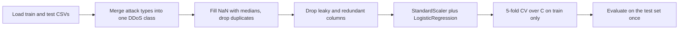

# Logistic Regression, Explained: Detecting DDoS Attacks with a Scaled, Cross-Validated Classifier


A hands-on crash course on **logistic regression**, built around a real cybersecurity problem: telling DDoS flood traffic apart from benign traffic using flow-level network features.

The repo has two goals:

1. **Teach** how logistic regression works (probabilities, log-loss, regularization, scaling, evaluation) in plain language.
2. **Show** a clean, leak-free workflow: preprocessing, a scaling pipeline, hyperparameter tuning with cross-validation on the training data only, and a single final evaluation on the test set.

> **Dataset:** train 16,000 rows, test 4,000 rows, 40 columns (flow features such as `Header_Length`, `Time_To_Live`, `Rate`, TCP flag counts, protocol indicators, and packet-size statistics), plus a `Target` label.
> CIC IoT dataset 2023

---

## Table of contents

1. [TL;DR](#tldr)
2. [Part I: Logistic regression crash course](#part-i-logistic-regression-crash-course)
3. [Part II: The project](#part-ii-the-project)
4. [Key takeaways](#key-takeaways)
5. [Run it yourself](#run-it-yourself)
6. [Further reading](#further-reading)

---

## TL;DR

- A **standardized** logistic regression with `C` chosen by 5-fold cross-validation on the training set classifies all **4,000 of 4,000** test samples correctly (benign vs. DDoS), with AUROC 1.000000.
- Scaling mattered: with the same `C` and the same columns, an unscaled run made 1 mistake on the test set. That is one sample, so treat it as a strong hint, not proof (see [the scaling experiment](#the-scaling-experiment)).
- A perfect score here says the classes are almost **linearly separable** on these features, not that the model is flawless. It also holds only for the attack types seen in training.

---

# Part I: Logistic regression crash course

## 1. Why not just use linear regression?

With a 0/1 target, linear regression produces scores that are not probabilities: they can be negative or greater than 1, and they aren't calibrated. Logistic regression fixes this by passing the same kind of linear score through a function that always lands between 0 and 1.


*Toy data, not from the project: the red linear fit leaves [0, 1]; the green logistic curve stays inside it.*

## 2. The idea: probability from a score

First compute a linear score from the features, exactly as in linear regression:

$$z = w_0 + w_1 x_1 + \dots + w_p x_p = \mathbf{w}^\top \mathbf{x} + b$$

Then convert it to a probability with the **sigmoid** (logistic) function:

$$p = P(y=1 \mid \mathbf{x}) = \sigma(z) = \frac{1}{1 + e^{-z}}$$


Large positive scores give probabilities near 1, large negative scores near 0, and a score of 0 gives exactly 0.5.

### Odds and log-odds

Rearranging the formula shows what the model is really linear in:

$$\ln\frac{p}{1-p} = \mathbf{w}^\top \mathbf{x} + b$$

- **Odds** = $\frac{p}{1-p}$ (e.g. $p = 0.8$ means odds of 4 to 1).
- **Log-odds** (the *logit*) = the natural log of the odds.

So logistic regression is a **linear model for the log-odds**. The probability is an S-curve, but the log-odds are a straight line in the features.

## 3. How it learns

There is no closed-form solution like the one linear regression has. Instead, the model finds the weights that make the observed labels most likely (**maximum likelihood**). Maximizing the likelihood is the same as minimizing the **log-loss** (binary cross-entropy):

$$\mathcal{L} = -\frac{1}{n}\sum_{i=1}^{n}\Big[y_i \ln p_i + (1-y_i)\ln(1-p_i)\Big]$$


Being wrong with high confidence is punished heavily: predicting $p = 0.01$ for a sample that is actually an attack costs far more than predicting $p = 0.4$. The weights are found iteratively (scikit-learn's default solver is L-BFGS, a gradient-based method), which is why the model has a `max_iter` setting and can warn when it hasn't converged.

## 4. The decision boundary and the threshold

To get a class from a probability we apply a threshold, 0.5 by default:

$$\text{class} = \begin{cases} 1\ (\text{DDoS}) & \text{if } p \ge 0.5 \\ 0\ (\text{benign}) & \text{if } p < 0.5 \end{cases}$$

Since $p = 0.5$ exactly when $z = 0$, the boundary between the two classes is the flat surface $\mathbf{w}^\top \mathbf{x} + b = 0$. That is why logistic regression is called a **linear classifier**: it can only separate classes with a straight line (a plane, or hyperplane, in many dimensions).

The threshold is a business decision. Lowering it catches more attacks and raises false alarms; raising it does the opposite.

## 5. Regularization and the parameter `C`

To stop the weights from growing without limit, scikit-learn applies **L2 regularization** by default. It adds a penalty on the size of the weights to the loss.

`C` is the **inverse** of the regularization strength:

| `C` | Regularization | Effect |
|---|---|---|
| Small (e.g. 0.01) | Strong | Weights shrunk toward zero, simpler model, can underfit |
| Large (e.g. 100) | Weak | Weights free to grow, closer to plain logistic regression, can overfit noisy data |

### Perfect separation

If the classes can be split perfectly by a hyperplane, plain logistic regression never settles: making the weights bigger always lowers the loss a little more, so they head toward infinity. Regularization is what keeps them finite.


*Toy data, not from the project. On perfectly separable data the weight keeps growing as regularization weakens.*

This matters here: the best `C` in our search sat at the **top of the grid** (100), which is what you would expect when the classes are almost perfectly separable.

## 6. Why feature scaling matters

For plain linear regression, rescaling a feature changes its coefficient but not the predictions. For regularized logistic regression, scaling changes the **result**:

- The L2 penalty is applied to the size of the weights. A feature measured in the hundreds of thousands (like `Rate`) needs only a tiny weight, so it is barely penalized. A feature measured in fractions (like `IAT`) needs a huge weight to matter, so it is heavily penalized. The model is quietly discounting features based on their units, not their usefulness.
- Features on wildly different scales make the optimization harder, so the solver can stop early or converge slowly.

The fix is to **standardize** features (subtract the mean, divide by the standard deviation) and to do it inside a `Pipeline`, so the scaler is fit only on the training data in every cross-validation fold:

```python
make_pipeline(StandardScaler(), LogisticRegression(max_iter=5000))
```

Tree-based models don't need this. Logistic regression does.

## 7. Interpreting coefficients

A weight $w_j$ is the change in **log-odds** for a one-unit increase in feature $j$, with the others held fixed. Exponentiating gives an **odds ratio**: $e^{w_j} = 1.5$ means the odds of "DDoS" are multiplied by 1.5.

Two cautions:

- After standardization, "one unit" means **one standard deviation**, which makes weights comparable across features.
- With strongly correlated or duplicated features, the weight can be split between them arbitrarily, so don't read individual coefficients in that situation (this is why `Tot size` and `Variance` were dropped, see below).

## 8. Classification metrics

Rows of the confusion matrix are the true class, columns the predicted class.

| | Predicted benign | Predicted DDoS |
|---|---|---|
| **Actually benign** | True negative | False positive |
| **Actually DDoS** | False negative | True positive |

- **Accuracy**: share of predictions that are correct.
- **Precision**: of everything flagged as DDoS, how much really was.
- **Recall**: of all real DDoS traffic, how much was caught. For a detector, a missed attack is usually the costly error.
- **F1**: the harmonic mean of precision and recall.
- **AUROC**: the probability that a random attack gets a higher predicted probability than a random benign sample. It ignores the threshold. 0.5 is chance, 1.0 is a perfect ranking.

AUROC needs probabilities (`predict_proba`), not hard class labels (`predict`).

## 9. Tuning with cross-validation

To choose `C` without touching the test set:

1. Split the **training** data into 5 folds (stratified, so each fold keeps the class balance).
2. For each candidate `C`, train on 4 folds and score on the 5th, rotating through all 5.
3. Pick the `C` with the best average score, refit on the full training set, and evaluate on the test set **once**.

`GridSearchCV` automates this. Choosing a threshold or hyperparameter by looking at test results turns the test set into a second training set, and the reported score stops being an honest estimate.

## 10. Assumptions and pitfalls

| Topic | What to know |
|---|---|
| **Linearity of the log-odds** | The model assumes the log-odds are a linear function of the features. Curved or interacting effects need feature engineering or a non-linear model |
| **Independence** | Samples should not influence each other. Neighboring network flows from one capture often do |
| **Multicollinearity** | Doesn't hurt predictions much, but makes coefficients unstable and hard to interpret |
| **Data leakage** | A feature that encodes the answer makes any model look brilliant |
| **Class imbalance** | Accuracy can hide poor recall on the rare class. Look at the confusion matrix, precision, and recall |
| **Calibration** | With weak regularization on separable data, probabilities get pushed toward 0 and 1, so don't read them as honest confidence |

---

# Part II: The project

## Task

Binary classification: **BENIGN (0)** vs **DDoS (1)**, where all seven flood types in the dataset are merged into the DDoS class.

| | Benign | DDoS | Total |
|---|---|---|---|
| Train (before cleaning) | 7,945 | 8,055 | 16,000 |
| Test | 2,055 | 1,945 | 4,000 |

The DDoS class contains seven flood types of roughly equal size in training (about 1,100 to 1,190 samples each): RSTFIN, TCP, ICMP, UDP, SYN, SYNONYMOUSIP and PSHACK floods.

## Pipeline



### Preprocessing steps

1. **Missing values.** 6 in the training set (in `Rate` and `Std`, among others), 0 in the test set. They are filled with column medians.
2. **Duplicates.** 108 duplicate rows were removed from the training set, leaving 15,892 rows.
3. **Leakage check.** `Number` has a correlation of 1.00 with the target:

   

   It takes the value 100 in 7,944 rows and 10 in 7,933 rows, and only 15 rows have anything else. That pattern looks like a data-collection artifact, not real traffic behavior, so the column was dropped. This leaves 38 features.
4. **Redundant columns.** `Tot size` has the same values as `AVG`, and `Variance` is the square of `Std`. Both were dropped, leaving **36 features**.

### A note on the plots


The target is binary, so each feature plot shows two horizontal bands, and the straight line is only a line drawn through them. The strongest features reach about |r| = 0.65 in the correlation chart, but the plots show the relationship is not linear in the probability. It is a step between two groups, which is exactly the shape a logistic (S-shaped) curve is built for.

### Model and tuning

```python
pipe = make_pipeline(StandardScaler(), LogisticRegression(max_iter=5000))
grid = GridSearchCV(
    pipe,
    param_grid={"logisticregression__C": [0.01, 0.1, 1, 10, 100]},
    cv=StratifiedKFold(n_splits=5, shuffle=True, random_state=42),
    scoring="roc_auc",
)
```

| Setting | Value |
|---|---|
| Features | 36 |
| Scaling | `StandardScaler`, fitted inside each CV fold |
| `C` grid | 0.01, 0.1, 1, 10, 100 |
| CV | 5-fold, stratified, scored by AUROC |
| Best `C` | **100** |
| Best CV AUROC (train only) | **0.999998** |

## Results (test set, evaluated once)

| Metric | Value |
|---|---|
| Accuracy | **1.00000** (4,000 of 4,000 correct) |
| Confusion matrix | `[[2055, 0], [0, 1945]]` |
| Precision / recall / F1 | 1.00 for both classes |
| AUROC | **1.000000** |

The 1.00 values in the classification report are rounded to two decimals. Zero errors in 4,000 samples does not prove the true error rate is zero: a rough 95% upper bound is about 0.075%.

## The scaling experiment

Same `C` (100), same dropped columns, only the scaler changed:

| Setup | Test errors |
|---|---|
| Without `StandardScaler` | 1 |
| With `StandardScaler` | **0** |

This is consistent with the mechanism in [section 6](#6-why-feature-scaling-matters), but it is a difference of **one test sample**, so it is suggestive, not conclusive. The more convincing check is to compare scaled and unscaled models with cross-validation on the training set (accuracy and log-loss over 15,892 samples).

## Comparison with linear regression

The same dataset and preprocessing were also used for a linear regression classifier (a Linear Probability Model), documented in the companion project.

| | Linear regression (threshold 0.7) | Logistic regression (scaled, `C = 100`) |
|---|---|---|
| Test accuracy | 0.99975 (1 error) | 1.00000 (0 errors) |
| AUROC | ≈ 1.0000 (rounded) | 1.000000 |
| Output | Unbounded score | Probability in [0, 1] |
| Tuning | None | `C` by 5-fold CV |

The two results differ by one sample, and the models also differ in preprocessing (36 vs. 38 features, scaled vs. unscaled), so this is not a clean head-to-head. The takeaway is that both reach essentially the same performance, which points to the data being easy.

## Why is the score so high?

A perfect score deserves suspicion. Findings from the analysis of the same data in the linear regression project:

- **One feature does most of the work.** `AVG` (average packet size) alone reaches 0.997 AUROC on the test set; `IAT` 0.991, `Rate` 0.989.
- **A single yes/no question is almost enough.** A depth-1 decision tree on `AVG` reaches 99.175% accuracy.
- **Only 132 of 4,000 test rows (3.3%)** also appear exactly in the training set, so duplicates cannot explain the score.
- **No leak was found** once `Number` was removed.

So the likely explanation is that flood traffic is easy to separate from benign traffic with these features. Because the classes are close to perfectly separable, a large `C` winning the grid search is exactly what you would expect.

## Limitations

- **Known attack types only.** The result covers the seven flood types present in both the training and test sets. In the linear regression project, a leave-one-attack-type-out experiment showed near-zero recall on held-out UDP, ICMP and PSHACK floods. That test was not repeated for logistic regression, but the same limitation likely applies because both are linear models on the same features.
- **Best `C` is at the edge of the grid.** `C = 100` was the largest value tried, so a larger value might score the same or better. The grid is worth extending (for example to 1,000 and 10,000).
- **Random split of one capture.** Neighboring traffic windows are similar, so a random split is friendlier than a split by time or capture session.
- **Balanced classes.** The data is roughly 50/50. Real traffic is not.
- **Probabilities may be overconfident.** With weak regularization on near-separable data, don't treat the predicted probabilities as calibrated confidence.

---

## Key takeaways

1. Logistic regression is a linear model for the **log-odds**: linear boundary, probabilistic output.
2. **Scale your features** before regularized logistic regression, and do it inside a `Pipeline`.
3. Choose hyperparameters with **cross-validation on the training set**, and touch the test set once.
4. When a result looks perfect, check for leakage, duplicates and redundant features, and ask what the data would let *any* model do.
5. State the scope of your claim: what the model was trained on is what it was tested on.

---

## Run it yourself

```bash
git clone https://github.com/<your-username>/<your-repo>.git
cd <your-repo>
pip install pandas numpy matplotlib seaborn scikit-learn jupyter
jupyter notebook Logistic_regression.ipynb
```

The notebook reads `../datasets/TrainingSet.csv` and `../datasets/TestingSet.csv`, so keep the notebook one folder below a `datasets/` folder (or edit the paths in the first code cell). Then run **Restart & Run All**.

---

## Further reading

- scikit-learn user guide: [Logistic regression](https://scikit-learn.org/stable/modules/linear_model.html#logistic-regression)
- James, Witten, Hastie, Tibshirani, *An Introduction to Statistical Learning*, Chapter 4 (classification). Free PDF at [statlearning.com](https://www.statlearning.com/)

---

## Author

[Your Name](https://www.linkedin.com/in/your-profile/) · feedback and questions welcome via Issues or LinkedIn.
